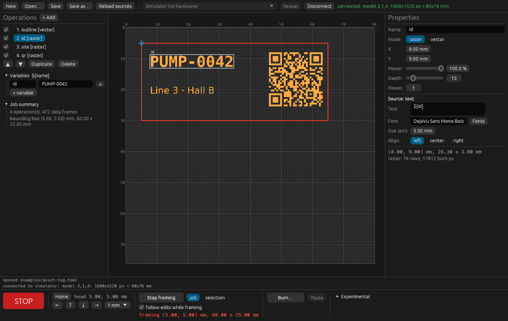

# k4laser — Linux software for K4 USB mini laser engravers

`k4laser` is a native Linux driver, GUI and CLI for **K4-class desktop mini
laser engravers**. These machines have an 80 × 76 mm work area, 0.05 mm
steps (508 dpi), a CH340 USB-serial port, and ship with the Windows-only
"Laser_K4ble" / "Laser Framework" software. Their protocol is a proprietary
binary one, not G-code or GRBL, so LaserGRBL, LightBurn and similar tools
cannot drive them.

It is built for engineering work rather than decoration: millimetre-exact
placement, repeatable job files, DXF input, asset tags and QR codes, and
calibration patterns. Before any burn you can preview the exact byte stream
the machine will receive.

It is a single self-contained binary, with no Python, Java, Wine or runtime
to install.



## Features

- **Exact framing for alignment.** The head traces the job's bounding box at
  standby (minimum) power, so you can position the workpiece precisely. It can
  frame the whole job or one operation, and can follow your edits live while
  framing. A burn is enabled only after the current geometry has been framed.
- **Job files, not just images.** A job is a TOML file of operations. Each
  operation has a position in mm, a power, a depth, a pass count and a source:
  - text: system fonts, multi-line, raster or vector outlines
  - image: PNG, JPEG, BMP, GIF, WebP or TIFF; threshold or Floyd–Steinberg
  - SVG: raster or vector
  - DXF: lines, polylines with bulges, arcs, circles, ellipses, splines and
    nested blocks; `$INSUNITS` honoured; layer filter
  - QR code: modules snapped to whole machine pixels
  - shapes: rectangle, circle, cross
  - ruler: a scale-calibration ruler
- **Variables.** `${id}` placeholders in text, QR data and paths. Burn a
  series with `--set id=PUMP-0043`.
- **Simulator and stream replay.** `simulate` streams the job to a simulated
  machine, then renders a 508 dpi PNG from the **bytes actually sent**, not
  from the design. `decode` turns a byte trace into readable frames.
- **Calibration.** `testgrid` writes a power × depth matrix job. The ruler
  source checks the scale with calipers.
- **GUI.** Canvas with a mm grid; drag operations (0.05 mm snap, 1 mm with
  Ctrl), nudge them with the arrow keys, and edit properties. Also: jog, home,
  pause/resume, progress with ETA, and a big STOP button (Esc).
- **CLI.** Every machine action is scriptable.

## Safety model

`k4laser` controls a laser. The software is **not** a safety device: wear
goggles rated for the laser's wavelength, extract the fumes, keep a fire
extinguisher nearby, and never leave a burn unattended.

What the software does:

- **It never guesses the port.** CH340 adapters have no serial number, so two
  of them look identical. The vendor software sends its handshake to every
  serial port; `k4laser` opens only the port you name.
- **It holds the port exclusively** (`flock` + `TIOCEXCL`). It refuses a port
  that another process holds, and names that process.
- **Frame before burn.** In the GUI, Burn stays disabled until the current
  geometry and position have been framed. Changing power or depth does not
  require a new framing; moving or editing geometry does.
- **Explicit confirmation.** The GUI uses a modal with a checkbox; the CLI
  asks you to type `BURN` (or pass `--yes`).
- **Stop on every failure path.** `STOP` is sent on Esc, Ctrl-C, any error
  or timeout, and when the program exits during framing.
  Pause is held by the host, so `STOP` always gets through.
- After a job the head position counts as unknown, and the head homes before
  the next positioning.

## Install

### Prebuilt binary

Tagged [releases](https://github.com/AnnoyingTechnology/k4-laser-engraver/releases)
include a `k4laser-x86_64-linux` binary, built against an old glibc so that it
runs on current distributions. The first release will follow hardware
validation. Install it with:

```sh
install -m 755 k4laser-x86_64-linux ~/.local/bin/k4laser
```

The binary needs glibc and a desktop session (Wayland or X11, OpenGL). It
finds system fonts on its own. File dialogs use the XDG desktop portal.

### From source

You need Rust 1.95 or newer.

```sh
cargo install --locked --git https://github.com/AnnoyingTechnology/k4-laser-engraver
```

### Serial port access

```sh
sudo usermod -aG dialout "$USER"   # Debian/Ubuntu/Fedora; "uucp" on Arch. Log out and in.
k4laser ports                      # stable by-path names, CH340 flag, current holders
```

Always use the `/dev/serial/by-path/…` name. It is tied to the physical USB
socket, whereas `/dev/ttyUSB*` and the by-id names of CH340 devices are not
stable. Save it once:

```toml
# ~/.config/k4laser/config.toml
port = "/dev/serial/by-path/pci-0000:00:14.0-usb-0:2:1.0-port0"

[settings]               # machine settings frame (0x28); omitted keys keep the vendor defaults
standby_intensity = 65   # framing / pointer intensity
```

If another program probes serial ports (ModemManager without its strict
filter, or a 3D-printer host), exclude the engraver's port from it.

## Use

```sh
k4laser                                     # GUI
k4laser gui examples/asset-tag.toml

k4laser probe                               # handshake + model; no motion
k4laser simulate job.toml -o preview.png    # exact replay of the byte stream
k4laser frame job.toml                      # trace the bounding box, Enter to stop
k4laser burn job.toml                       # frame, confirm, burn
k4laser burn job.toml --op 2 --set id=PUMP-0043
k4laser home
k4laser jog 10 5                            # home, then move by (10, 5) mm
k4laser testgrid -o grid.toml --powers 20,40,60,80,100 --depths 5,10,20,40,80
k4laser decode trace.bin                    # bytes -> frames (use with --trace)
```

Add `-v` to log every protocol byte, or `--trace FILE` to record them.

### Job file

Coordinates are in mm from the top-left of the work area. An operation is
placed by the top-left corner of its ink, so `x_mm`/`y_mm` is exactly where
burning starts. A ruler is placed by tick 0.

```toml
[variables]
id = "PUMP-0042"

[[op]]
name = "outline"
mode = "vector"          # vector | raster (per-source defaults)
x_mm = 5.0
y_mm = 5.0
power = 100              # percent
depth = 40               # 0-100, dwell per pixel
passes = 1
[op.source]
type = "shape"
shape = "rect"
width_mm = 60.0
height_mm = 25.0

[[op]]
name = "id"
x_mm = 8.0
y_mm = 9.0
power = 100
depth = 15
[op.source]
type = "text"
text = "${id}"
font = "DejaVu Sans Mono Bold"
size_mm = 5.0            # em size

[[op]]
name = "qr"
x_mm = 46.0
y_mm = 7.0
[op.source]
type = "qr"
data = "https://example.com/asset/${id}"
module_mm = 0.6
ecc = "M"
```

| `type` | Modes | Main keys |
|---|---|---|
| `text` | raster, vector | `text`, `font`, `size_mm`, `align` |
| `image` | raster | `path`, `width_mm`, `height_mm`, `dpi`, `threshold`, `dither`, `invert` |
| `svg` | raster, vector | `path`, `width_mm`, `threshold`, `invert`, `tolerance_mm` |
| `dxf` | vector | `path`, `scale`, `layers`, `tolerance_mm` |
| `qr` | raster | `data`, `module_mm`, `ecc` (L/M/Q/H) |
| `shape` | vector, raster | `shape` (rect/circle/cross), `width_mm`, `height_mm` |
| `ruler` | vector | `length_mm`, `step_mm`, `labels`, `font`, `label_mm` |

Relative paths are resolved from the job file's directory. Unknown keys are
rejected, so a typo cannot silently fall back to a default. See
[`examples/`](examples/).

### Typical workflow

1. Burn `testgrid` on scrap of the material and pick the power and depth.
2. Build the job in the GUI, or write the TOML by hand.
3. Check it with `simulate`, which shows exactly what the machine will burn.
4. Frame it, and align the workpiece to the red trace.
5. Burn.

## Hardware status

The protocol was reconstructed from the vendor application; see
[PROTOCOL.md](PROTOCOL.md). The test suite checks the byte stream against the
simulator: layout, ordering, resend on NAK, cancel, and framing. Validation on
real hardware is in progress. These points are still unconfirmed:

- whether `START` coordinates are absolute or relative to the head
- the unit of `depth`
- what the machine does after `STOP`
- what the hidden `0xFD`/`0xFE` commands do (`k4laser aux on|off`; possibly an
  auxiliary output such as the fan)

Reports from other K4 owners are welcome. A `--trace` capture with a
description of what the machine did is the most useful thing to send.

## Development

```sh
cargo test                  # unit + end-to-end tests against the simulator
cargo clippy --all-targets
K4LASER_SELFTEST_SIM=1 K4LASER_SCREENSHOT=/tmp/gui.png cargo run -- gui examples/asset-tag.toml
```

## Keywords

K4 laser engraver Linux, K4 mini laser engraver software, Laser_K4ble
alternative, Laser Framework alternative, CH340 laser engraver, 1500 mW /
3000 mW desktop laser engraver driver, open source laser engraving software,
DXF to laser, QR code laser engraving, asset tag engraving, Wayland, Rust.

## License

GPL-3.0-or-later. Not affiliated with the manufacturer of the engraver or of
its software.
